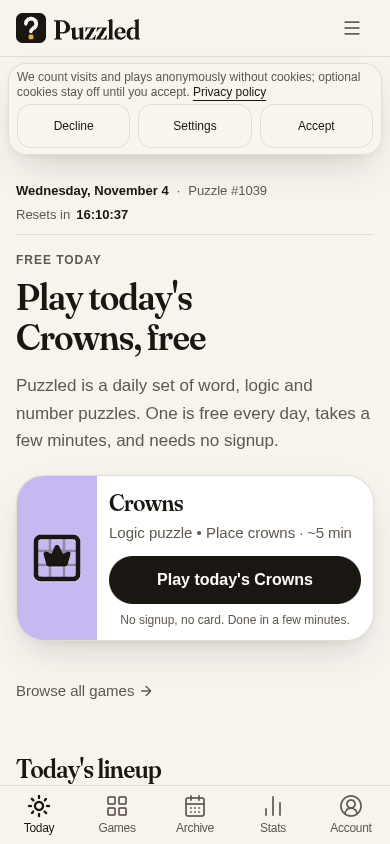
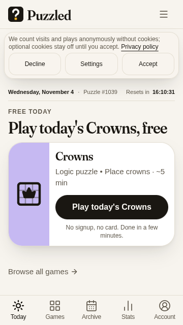

# Phone first screen

A fresh phone visit must show the entire daily card and its Play action above the bottom tabs. Consent occupies its own page space below the header rather than covering the card. Both consent choices remain available. Short phones use a compact masthead; wider/taller screens keep the full introductory copy.

The card retains its real game destination and `start=1#play` action; this layout change does not change game rules, progress, account state or entitlements.

## Paired evidence

The baseline is the signed-out public page captured on 2026-11-03 at 23:35–23:36 UTC. The candidate is the local source build captured at 23:49 UTC, with after-consent checks on 2026-11-04 at 00:07 UTC. These are browser captures, not design mockups or public-rollout claims.

| Viewport | Public baseline | Local candidate |
| --- | --- | --- |
| 390x844 |  |  |
| 360x640 |  |  |

## Answering consent

The regression clicks Reject/Decline and verifies that the banner vanishes and its complete reserved space is removed, including margins. The first content moves up without an empty slot.

## Verification

The production Next build passed compilation, TypeScript and route generation. Thirteen targeted unit tests passed. Both new first-visit browser cases passed against that production build through the supported native headed-browser CDP fixture, including actual Decline and no-gap assertions. Ordinary Playwright launch failed before assertions because host Chromium has no usable sandbox; it was not bypassed.

[Machine receipt](phone-first-screen/local-acceptance.json) records source and loaded document/asset SHA-256 values plus geometry. Session headers are intentionally excluded.

## Regression principle

A transient choice on a short screen must either reserve real layout space or leave the useful content unobscured. Check the complete first-visit state, the smallest supported viewport, the fixed navigation and a real choice click—not only a settled page with consent already stored.
